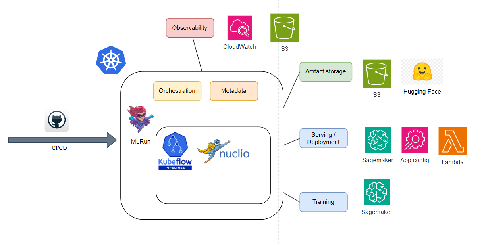
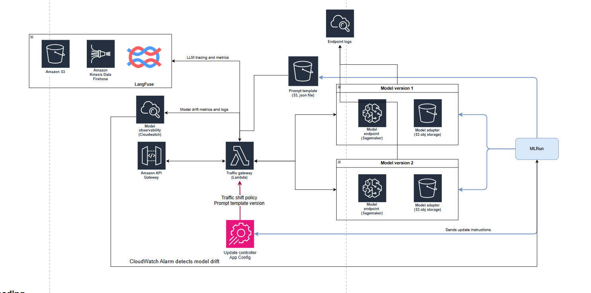
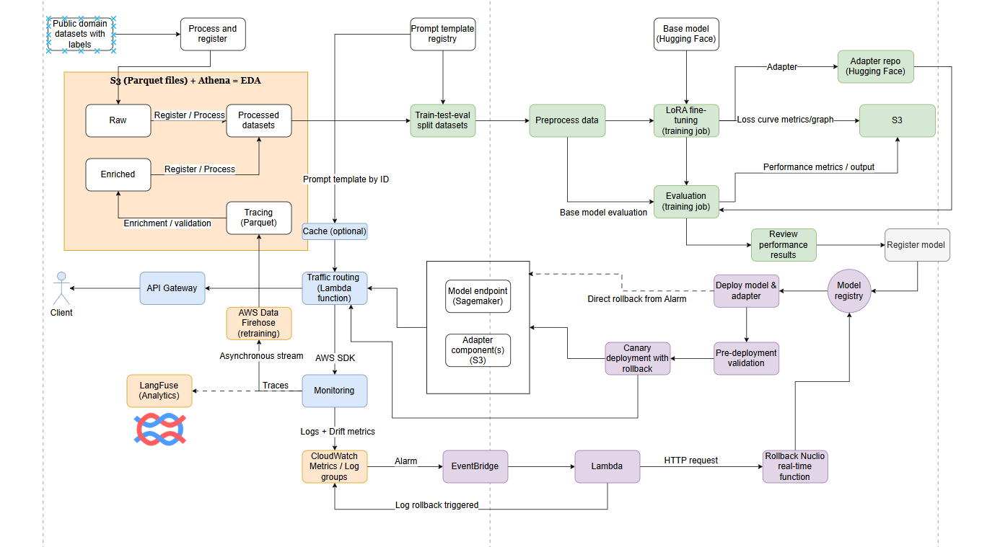

# Legal Contract Analysis LLM: Fine-Tuning and MLOps on AWS

An MLOps project for fine-tuning and serving an open-weight language model that analyzes non-disclosure agreements (NDAs). Given a contract, the model classifies 17 ContractNLI hypotheses as **entailment**, **contradiction**, or **not_mentioned**, and returns supporting clauses as structured JSON.

The project uses Hermes-4-14B, QLoRA, MLRun, and AWS to connect dataset preparation, training, evaluation, registration, deployment, and monitoring. Training is designed around long contract prompts, reported at up to approximately 11,000 input tokens, and the memory constraints of NVIDIA L40S GPUs.

## Contents

- [Project status](#project-status)
- [Example input and output](#example-input-and-output)
- [Reported results](#reported-results)
- [Architecture](#architecture)
- [MLOps workflows](#mlops-workflows)
- [Getting started](#getting-started)
- [Repository layout](#repository-layout)
- [Documentation](#documentation)
- [Limitations and next steps](#limitations-and-next-steps)
- [License](#license)

## Project status

An AWS CPU-only workflow is deployed from `feat/aws-cpu-deployment`.
Its [cloud check instructions](docs/cloud-demo.md) cover isolated data
processing and evaluation of supplied predictions. This path does not launch
GPU jobs, provide live model inference or run MLRun. The first AWS CodeBuild
check passed 15 tests and processed 423 training and 61 validation documents.
Supplied AWS execution output confirms the [Step Functions workflow](docs/cpu-workflow.md)
succeeded end to end: it waited for CodeBuild to complete and publish verified
outputs to private S3. The [run-registry Lambda and DynamoDB table](docs/cpu-run-registry.md)
are deployed and independently verified, including duplicate handling.
The integrated workflow has also succeeded end to end, returning a newly
registered COMPLETED run with the expected document counts. The [authenticated
status API](docs/cpu-status-api.md) is deployed: signed requests returned HTTP 200
with the expected counts and artifact versions, unsigned requests returned 403,
and an unregistered run returned 404. Its test/package build succeeded in AWS.
Submission and other management routes remain pending. The
[dataset/prompt catalog](docs/cpu-artifact-catalog.md#verified-cloud-evidence)
also passed its AWS build (32 CPU and 28 cloud tests): the official train,
validation and held-out test splits and canonical prompt/schema are registered
in versioned private S3. Counts are 423/61/123 documents; all split/provenance
checks passed. This catalog is not yet integrated with the API.
A [historical CPU evaluation replay](docs/cpu-historical-evaluation.md) is now
prepared for an AWS build using saved benchmark responses and the registered
test references; its metrics have not yet been verified. Historical experiments
are separate.

This portfolio implementation includes experiment outputs and serving benchmarks. Running the platform requires configured AWS infrastructure and an accessible MLRun environment.

| Area | Current state | Evidence |
| --- | --- | --- |
| Data preparation and registration | Implemented in scripts and notebooks | [Dataset engineering](dataset_engineering/), [registration handler](src/register_raw_dataset.py) |
| QLoRA training and evaluation | Implemented; training curves and reported metrics included | [Training workflow](src/evaluate_train.py), [experiment details](docs/training-and-evaluation.md) |
| Model registry and deployment | Model/adapter deployment and registry status logic are present | [Model deployment](src/deploy_model.py), [adapter deployment](src/deploy_adapter.py), [registry helpers](src/utils_model_registry.py) |
| Serving and monitoring | Lambda, SageMaker helpers, CloudWatch metrics, and AppConfig configuration are present | [Gateway code](images/lambda_gateway/model_gateway.py), [Terraform](Terraform/), [benchmarks](benchmark/) |
| CI/CD | Definitions are present, but both workflows stop before deployment; several function builds are commented out | [CI](.github/workflows/dev-pr-open.yml), [CD](.github/workflows/dev-pr-closed.yml), [build script](setup/build_functions.py) |
| Production feedback and long-term rollback | Designed; Firehose/Langfuse export and EventBridge/Nuclio rollback are incomplete | [Implementation boundaries](docs/architecture.md#implementation-boundaries) |

The existing diagrams show the target architecture, including planned integrations. They do not imply that every component is provisioned or operational.

## Example input and output

A short excerpt from the sample NDA:

> 8. The undertakings in clauses 2 and 3 will continue in force indefinitely.

One prediction from the sample response:

```json
{
  "Hypotheses": [
    {
      "hypothesis": "Some obligations of Agreement may survive termination of Agreement.",
      "hypothesis_id": "nda-19",
      "label": "entailment",
      "source_clause": "8. The undertakings in clauses 2 and 3 will continue in force indefinitely."
    }
  ]
}
```

This shows one of the 17 hypotheses. The [full sample](<sample input output.txt>) includes the contract and complete response. Supporting evidence uses the `source_clause` field; `not_mentioned` predictions use an empty clause.

## Reported results

These values were recorded in the original README. The second run was presented as an evaluation example without a complete run identifier or model/adapter revision.

| Recorded run | Scored documents | Average label accuracy | Average extraction F-measure |
| --- | ---: | ---: | ---: |
| Hermes-4-14B baseline | 119 | 77.43% | 0.6653 |
| Additional evaluation example; run identity unspecified | 121 | 87.63% | 0.8237 |

These are separate recorded runs with different document counts. A controlled improvement claim requires the same evaluated documents, prompt version, inference settings, and metric implementation, plus explicit model and adapter revisions.

Evaluation uses label matching and **ROUGE-3** evidence overlap. Correct `not_mentioned` predictions receive an extraction score of `1.0`, so the extraction F-measure is a project-specific aggregate. Evaluation scripts also omit malformed or empty JSON responses from the scored outputs.

See [metric definitions](<docs/model metrics.md>) and [training/evaluation details](docs/training-and-evaluation.md) for raw results, training curves, and serving measurements.

## Architecture

MLRun manages jobs and artifact metadata; AWS provides training and serving infrastructure. Dataset/prompt versions, evaluation artifacts, and model/adapter revisions connect the lifecycle stages.



*Platform stack: MLRun coordinates execution and metadata; SageMaker, Lambda, AppConfig, CloudWatch, S3, and Hugging Face support the surrounding workflows.*

| Responsibility | Components |
| --- | --- |
| Orchestration and metadata | MLRun; Kubernetes jobs |
| Data preparation | PyArrow, Hugging Face Datasets, Transformers |
| Fine-tuning | PyTorch DDP, PEFT/QLoRA, bitsandbytes, SageMaker training jobs |
| Evaluation and inference | vLLM; SageMaker training jobs and endpoints |
| Request handling and traffic configuration | Lambda and AppConfig |
| Monitoring | CloudWatch logs, hypothesis-label counts, and quote-overlap metrics |
| Storage and version references | S3/Parquet, MLRun artifact keys/tags, Hugging Face commit hashes |
| Infrastructure and delivery | Terraform, container images, GitHub Actions definitions |

The target serving path is API Gateway -> Lambda -> SageMaker. Lambda combines the contract with a versioned prompt and selects an endpoint/adapter using AppConfig.



*Target serving design. API Gateway and Firehose/Langfuse export need additional implementation or configuration. The current Lambda handler reads a top-level `contract` field.*

See [architecture details](docs/architecture.md) for registry lineage, observability, deployment strategies, and rollback.

## MLOps workflows



*Lifecycle overview. Production-data enrichment, external tracing, and long-term rollback are planned extensions.*

| Workflow | Entry point | Outputs |
| --- | --- | --- |
| Process and register datasets | [register_raw_dataset.py](src/register_raw_dataset.py) | Versioned train/validation/test artifacts |
| Evaluate a base model | [evaluate_no_train.py](src/evaluate_no_train.py) | Predictions and metrics |
| Train and evaluate an adapter | [evaluate_train.py](src/evaluate_train.py) | Adapter revision, loss history, predictions, and metrics |
| Register a model | [register_model.py](src/register_model.py) | Model artifact and metadata |
| Deploy a model and adapter | [deploy_model.py](src/deploy_model.py) | Endpoint/adapter references and traffic configuration |
| Deploy an adapter update | [deploy_adapter.py](src/deploy_adapter.py) | Adapter deployment and traffic update |

Training uses 4-bit NF4 weights, BF16 computation, gradient checkpointing, and an 8-bit paged optimizer. The configured training instance is `ml.g6e.12xlarge`, with four 48 GB L40S GPUs using DistributedDataParallel (DDP). [Training details](docs/training-and-evaluation.md#training) cover memory settings and loss curves.

## Getting started

### Prerequisites

- Python **3.11** for local orchestration/CI, matching the repository's CI configuration.
- AWS credentials, SageMaker GPU quota, and permissions for the required S3, ECR, IAM, Lambda, AppConfig, and CloudWatch resources.
- An accessible MLRun **1.11.0** environment.
- A Hugging Face token with model access and adapter-repository write permission for training.
- Docker, AWS CLI, Terraform, and, for local MLRun installation, Kubernetes tooling and Helm. Shell scripts require Bash, such as WSL on Windows.

### Prepare the Python environment

From the repository root:

```bash
python -m venv .venv
```

Activate with `.venv\Scripts\Activate.ps1` in PowerShell or `source .venv/bin/activate` in Bash, then install the recorded host dependencies:

```bash
python -m pip install -r requirements.txt
```

GPU training and evaluation use separate container images. Installing host dependencies does not provision the platform.

### Run a workflow

1. Configure AWS authentication and the [required environment variables](docs/getting-started.md#configuration).
2. Adapt account IDs, bucket names, model repositories, backend settings, and MLRun addresses.
3. Connect to MLRun and register the required functions, datasets, and prompt.
4. Follow the [notebook order](docs/getting-started.md#notebook-execution-order), starting with data registration and base-model evaluation.

The [setup guide](docs/getting-started.md) explains current constraints. `setup/setup.sh` is not a one-command bootstrap: the project creation script exits when the checked-in `project.yaml` exists, and the build script is partially enabled. Tests require an MLRun/AWS environment.

## Repository layout

```text
.
|-- dataset_engineering/   # ContractNLI conversion, EDA, prepared datasets
|-- src/                   # MLRun handlers, deployment and registry helpers
|   +-- scripts/
|       |-- training/      # QLoRA training entry points
|       +-- evaluate/      # Base-model and adapter evaluation
|-- notebooks/             # Setup and workflow examples
|-- images/                # GPU training, MLRun, and Lambda containers
|-- Terraform/             # AWS infrastructure and backend configuration
|-- k8s/                   # MLRun installation and local service notes
|-- benchmark/             # Load tests and recorded responses/summaries
|-- diagram/               # Architecture, screenshots, and loss curves
|-- docs/                  # Setup, architecture, training, and metrics
|-- setup/                 # Project creation and partial build automation
|-- tests/                 # MLRun/AWS integration smoke test
+-- project.yaml           # MLRun project definition
```

## Documentation

- [Setup and workflow guide](docs/getting-started.md)
- [Architecture, deployment, and observability](docs/architecture.md)
- [Training, evaluation, and serving benchmarks](docs/training-and-evaluation.md)
- [Metric definitions](<docs/model metrics.md>)
- [ContractNLI dataset](https://stanfordnlp.github.io/contract-nli/)
- [Hermes-4-14B model](https://huggingface.co/NousResearch/Hermes-4-14B)

## Limitations and next steps

- Complete CI/CD validation against an accessible MLRun target.
- Implement production-data export/enrichment and the long-term rollback integration.
- Publish evaluation manifests with model/adapter revisions, dataset/prompt tags, generation settings, and excluded-response counts.
- Add exact evidence-span validation and JSON-validity reporting. ROUGE overlap does not guarantee a verbatim quote.
- Validate serving limits against the full input-plus-output token budget.
- Expand load testing: recorded tests include failed requests and are exploratory.
- Re-export diagrams from editable sources to remove editor guides/selection handles and mark planned components.

## License

Released under the [MIT License](LICENSE).
