# Architecture, Deployment, and Observability

[Back to the README](../README.md)

The diagrams show the target architecture, including integrations that are still planned. This document connects that design to the code currently in the repository.

## Contents

- [Platform design](#platform-design)
- [MLRun and CI/CD](#mlrun-and-cicd)
- [Data and model registries](#data-and-model-registries)
- [Serving and deployment](#serving-and-deployment)
- [Monitoring and rollback](#monitoring-and-rollback)
- [Implementation boundaries](#implementation-boundaries)

## Platform design

MLRun provides job orchestration and artifact metadata. AWS supplies training, serving, traffic configuration, storage, and monitoring. This lets the project customize its lifecycle without operating every service directly on Kubernetes.

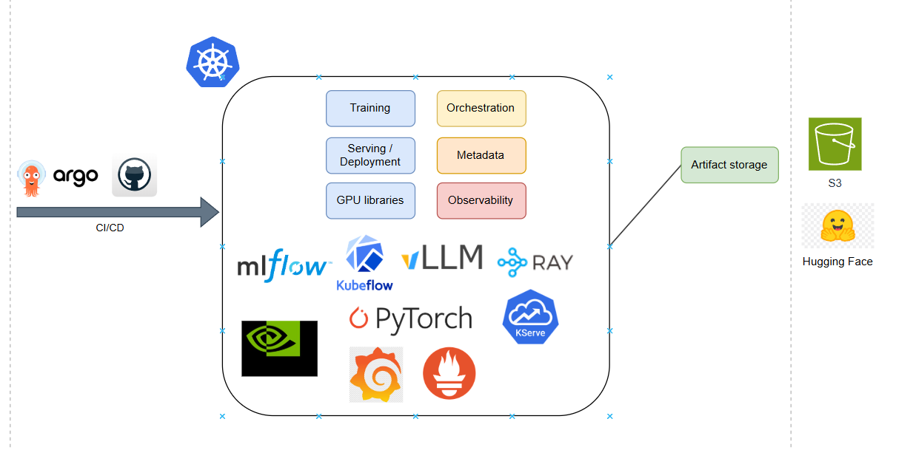

*Alternative stack considered during design.*

*Selected division of responsibilities.*

## MLRun and CI/CD

Functions wrap data registration, evaluation, training, model registration, and deployment. [project.yaml](../project.yaml) records their names, handlers, and image references.

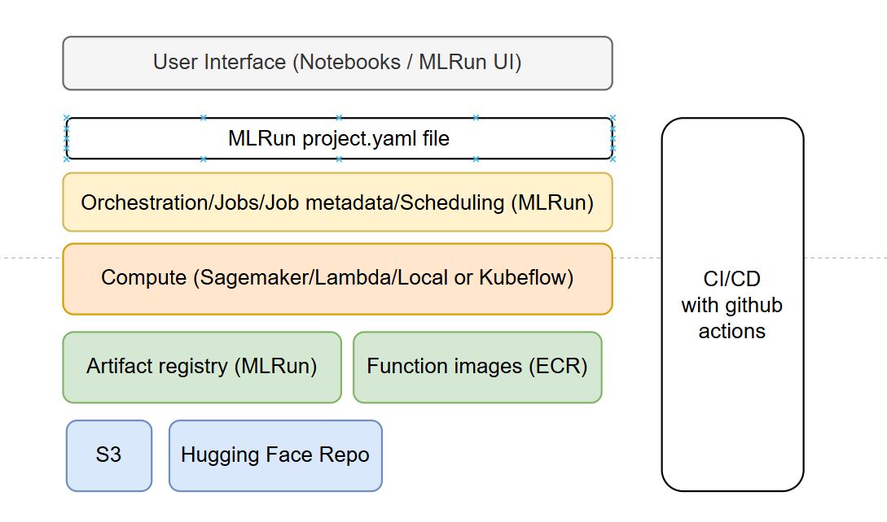

*Project-level functions and artifacts.*

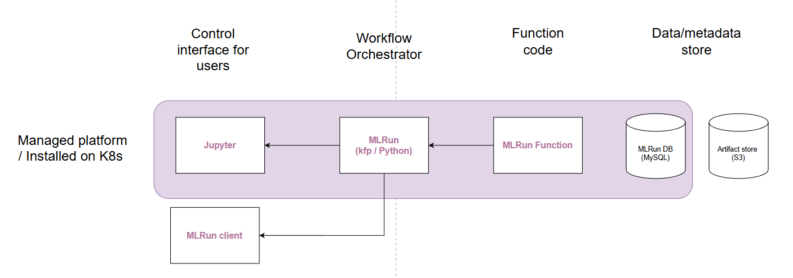

*The environment surrounding the project.*

Application code/dependency changes can require rebuilding images under [images/](../images/). A job-code change does not require redeploying the MLRun control plane.

[build_functions.py](../setup/build_functions.py) builds selected functions from repository code. Several builds are commented out to reduce development build time. A handler's presence in `project.yaml` does not prove that its current image has been rebuilt.

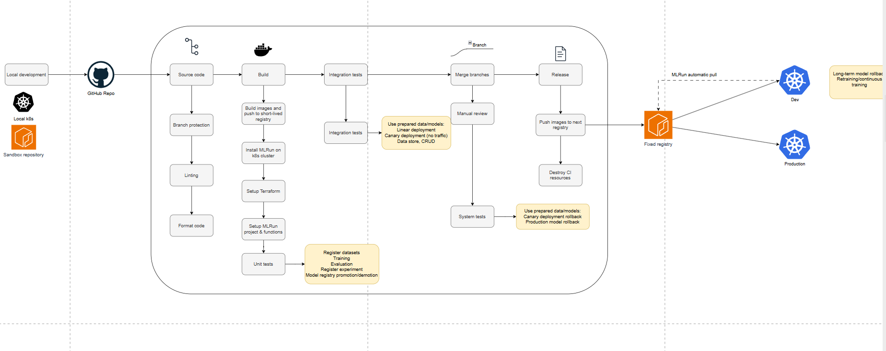

*Intended build and validation flow.*

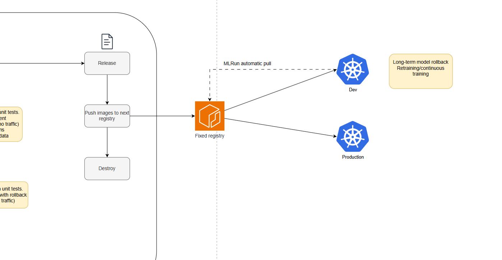

*Intended delivery flow after a merge.*

Both [CI](../.github/workflows/dev-pr-open.yml) and [CD](../.github/workflows/dev-pr-closed.yml) contain a stopping step because the intended MLRun platform subscription is not configured. Later deployment/test steps do not demonstrate working automation.

An ephemeral Minikube installation was attempted and abandoned after repeated MySQL startup failures. A persistent MLRun target became the intended CI approach. The local installation helper remains in [k8s/install.sh](../k8s/install.sh).

The monorepo keeps shared code, infrastructure, images, and notebooks together for a single-maintainer project. Current workflows process application changes broadly and ignore documentation-only changes; path-based jobs could narrow future builds.

MLRun screenshots and upstream lifecycle references

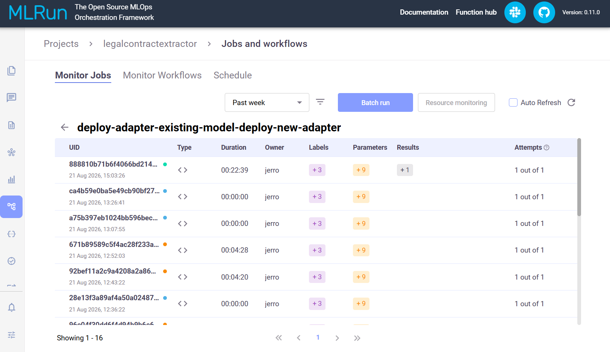

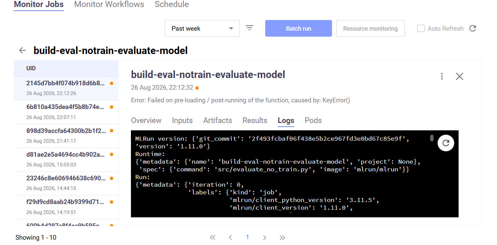

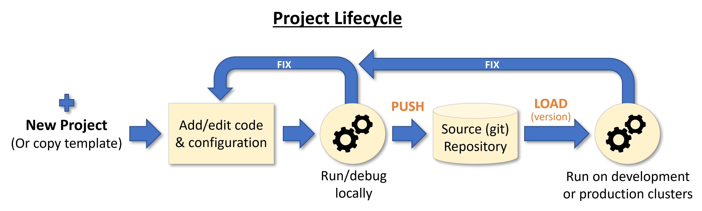

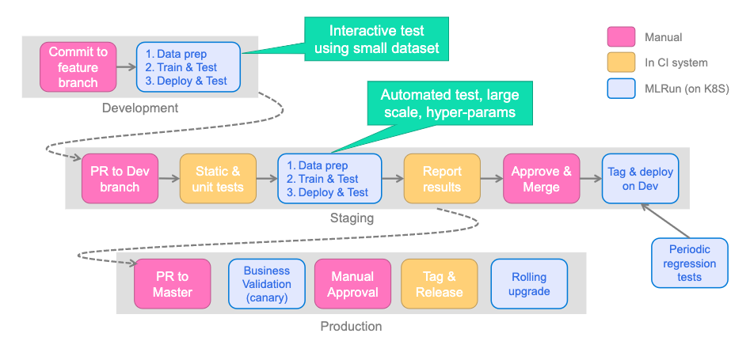

The last two images are upstream MLRun illustrations; their sources are recorded in [references.txt](../diagram/official/references.txt).

## Data and model registries

Train/validation/test data and prompts are registered as MLRun artifacts with keys and tags. S3 holds Parquet datasets, prompts, training history, and evaluation outputs. Hugging Face commit hashes identify adapter revisions.

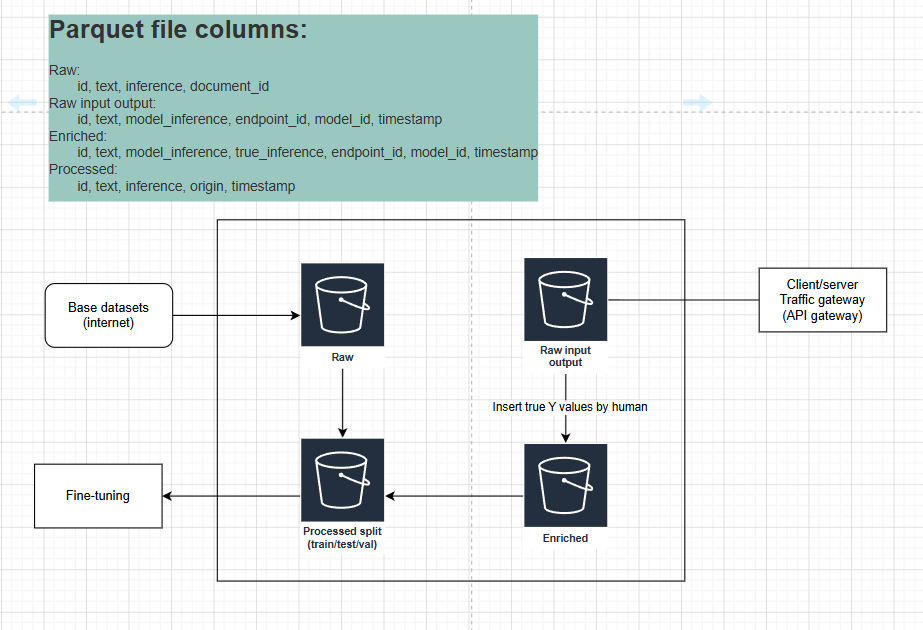

*Trace ingestion and production-data enrichment are incomplete.*

[Terraform/main.tf](../Terraform/main.tf) enables S3 bucket versioning. Object versioning and MLRun dataset tags serve different purposes; versioning does not implement enrichment or dataset-management operations.

[utils_model_registry.py](../src/utils_model_registry.py) manages status labels:

| Status | Role |
| --- | --- |
| `standby` | Registered model outside the active champion/challenger roles |
| `challenger` | Candidate for promotion |
| `champion` | Model designated as active |

When a challenger replaces a champion, the old model receives a `replaced` label referencing the new model's tag. Artifact tags identify versions; status/replacement labels describe role and lineage.

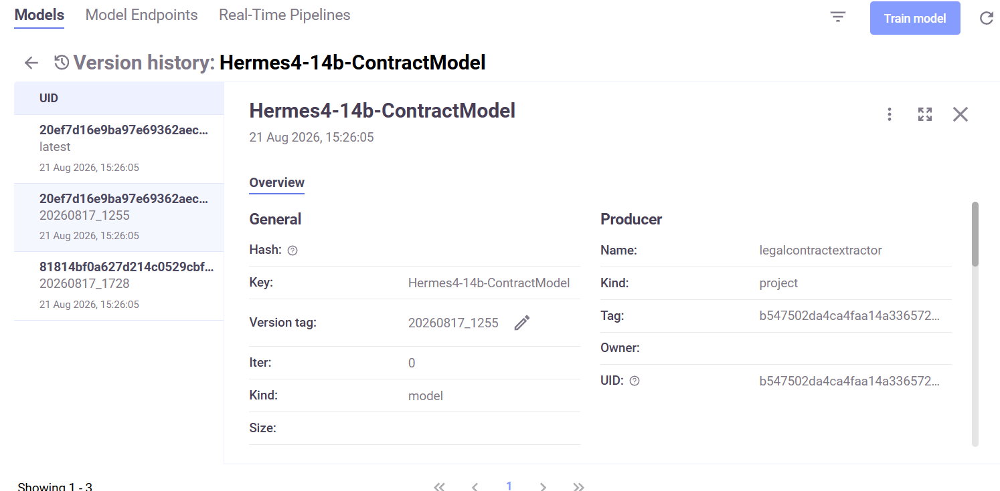

*Registry artifacts and metadata.*

## Serving and deployment

The target request path is API Gateway -> Lambda -> SageMaker. Lambda combines the contract with a prompt and reads endpoint, adapter, and prompt settings through AppConfig.

*API Gateway event mapping and the Firehose/Langfuse export path need additional work.*

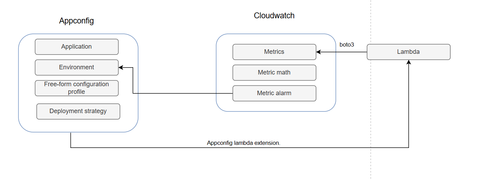

*AppConfig controls the gateway's deployment configuration.*

[deploy_model.py](../src/deploy_model.py) deploys a model/adapter, performs checks, updates traffic, and manages registry status. [deploy_adapter.py](../src/deploy_adapter.py) targets an adapter update on an existing endpoint.

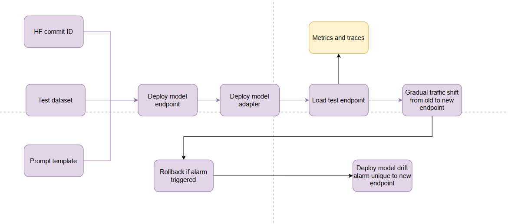

*New model and adapter deployment.*

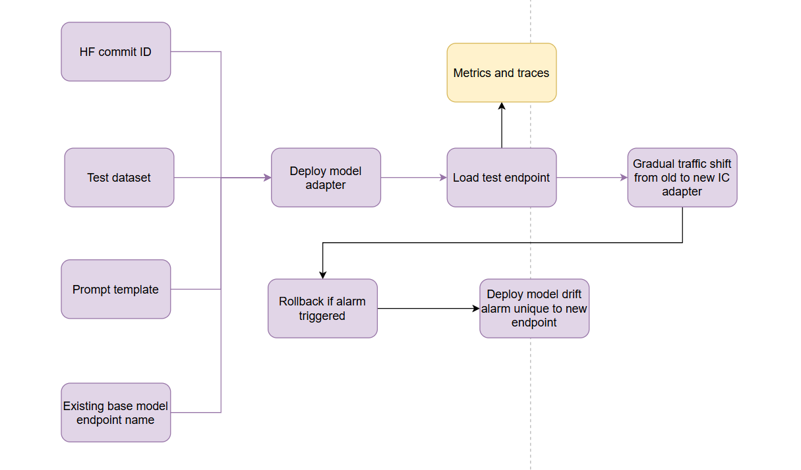

*Adapter update on an existing model.*

Infrastructure defines direct and gradual AppConfig deployment strategies. [Serving helpers](../src/utils.py) configure vLLM/LMI endpoints and autoscaling. See [serving settings and benchmarks](training-and-evaluation.md#serving-and-benchmarks).

## Monitoring and rollback

The [gateway](../images/lambda_gateway/model_gateway.py) emits logs/timings, label counts by hypothesis ID, and `CARP_3` quote-overlap scores. Short-term metrics support rollout monitoring; long-term metrics include endpoint/adapter dimensions.

These are quality/distribution signals, not production ground-truth accuracy. Changes may reflect different input contracts as well as model behavior. [Metric definitions](<model metrics.md>) explain their limitations.

### During a rollout

CloudWatch alarms attached to AppConfig monitoring support restoring the prior traffic configuration during deployment/bake time. This mechanism is represented in Terraform and deployment helpers.

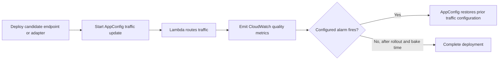

*Configured rollout mechanism; successful end-to-end CI validation remains outstanding.*

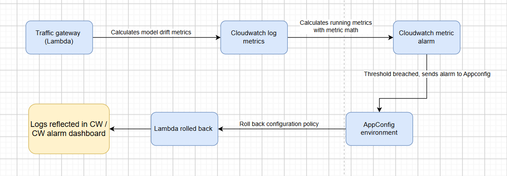

*Detailed rollout rollback design.*

### After deployment

The target long-term rollback path is CloudWatch alarm -> EventBridge -> Lambda -> Nuclio real-time function -> traffic update and registry reconciliation.

The complete chain is not implemented here; the long-term alarm helper also leaves action wiring unset. This differs from AppConfig's rollout monitoring.

### Production feedback

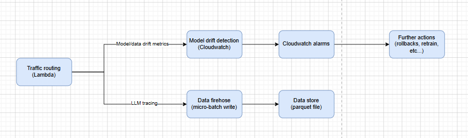

*Target observability and feedback design.*

The intended Firehose-to-S3 path captures contract inputs/outputs for enrichment and retraining. Langfuse is an optional tracing integration in the diagrams. The current gateway contains an export comment without a completed delivery implementation.

## Implementation boundaries

| Component | Present | Remaining work |
| --- | --- | --- |
| Data registry and S3 versioning | Handlers, artifact tags, bucket-versioning resource | Trace ingestion and enrichment |
| Model/adapter serving | Deployment helpers and recorded benchmarks | Revalidate serving limits and deployment in the target environment |
| AppConfig rollout monitoring | Strategies, monitoring configuration, traffic updates | End-to-end CI/rollback validation |
| CloudWatch quality metrics | Per-hypothesis and model/adapter metrics | Threshold calibration and operational validation |
| API Gateway | Target diagram | Provision/configure gateway and event mapping |
| Firehose/Langfuse | Diagrams and gateway comment | Implement trace delivery |
| EventBridge/Nuclio rollback | Target design and alarm helper | Wire actions and implement/validate rollback handler |
| Automated CI/CD | Workflow definitions | Configure target, repair stopping steps, enable required builds |

See the [setup guide](getting-started.md) for environment requirements and notebook execution order.
