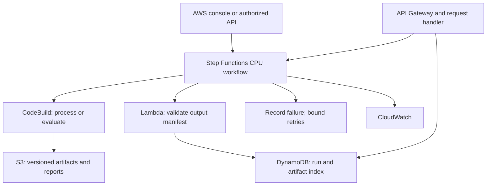

# AWS-only deployment using existing credits

Updated 23 October 2026 (IST). Original audit source: `de13969e5624cfb3862762986c8197ca348924e2`. Verified deployed submission package: `e533237a61f7c49e09d69d1e0a7f3f7629378f79`.

This plan supersedes `deployment-plan.md` for the current deployment. Requirements: no local application, processing, tests, builds or orchestration; no account upgrade; no GPU resources; preserve the existing AWS credit balance. Editing this plan does not implement the fixes or provision resources.

Current milestone: [cloud-demo.md](cloud-demo.md) records the first AWS CPU check (15 tests passed; 423 training and 61 validation documents processed). The account owner confirmed the three private S3 outputs and supplied a matching manifest from commit `8a1df10`. Supplied AWS output also confirms successful definition validation and an end-to-end [Step Functions execution](cpu-workflow.md), including CodeBuild success and the new S3 prefix. The registry Lambda/table have now passed independent real registration and duplicate handling checks. Automated workflow registration also passed AWS validation/update and a real integrated smoke test. The read-only IAM status API also passed its cloud test/package build and real HTTP 200/403/404 checks. The dataset/prompt catalog subsequently passed its AWS build, recovering and registering all three official splits and the canonical prompt in versioned S3. A historical prediction replay also succeeded after 84 tests, publishing versioned reports for the benchmark subset. The catalog/evaluation metadata routes and bounded submit/status API have since been deployed. Real checks verified completed-key replay, an ABORTED execution with its exact child STOPPED/complete, retained-lock rejection and conditional manual lock release. The three-admission counter was preserved and POST left disabled. A final seven-check API regression passed, and three CPU alarms were deployed with a matching synthetic workflow-alarm email received by the operator. Broader failure coverage, a post-recovery processing run, infrastructure recreation and measured consumption remain unverified; billing review was skipped at the account owner's request. The fix tables below describe the complete target, not a claim that every fix is implemented.

## 1. What will actually be deployed

The first release is an AWS-hosted CPU workflow for ContractNLI data processing, validation, versioned dataset/prompt artifacts, run tracking, evaluation of supplied prediction files, logs and an authenticated management API.

It is a smaller deployment than the original full architecture. It will not generate new Hermes-4-14B predictions, run QLoRA training, deploy SageMaker/vLLM, run MLRun or demonstrate model traffic rollback. Step Functions coordinates this CPU release. S3 manifests and DynamoDB provide a simple artifact/run index, not a deployed MLRun model registry. Existing MLRun/GPU modules remain a separate future path.

All execution and build/test work happens in AWS. The computer is only a browser client; GitHub remains source control. No local Python, Docker, Kubernetes, MLRun or background server is needed.

| Activity | Where it happens |
| --- | --- |
| Account checks, resource inspection and demonstrations | AWS console |
| Source checkout/editing and administrative commands | AWS CloudShell |
| Tests, dependency installation, packaging and deployment jobs | AWS CodeBuild |
| Parquet processing and CPU evaluation | Finite AWS CodeBuild jobs |
| Manifest validation, run status and API handlers | AWS Lambda |
| Coordination | AWS Step Functions Standard |
| Durable inputs, outputs, prompts, manifests and state | S3 |
| Run/artifact metadata | DynamoDB |

CloudShell is remote compute accessed through the browser. Its limited storage/session lifetime makes it an administration workspace, not a permanent application host. Keep durable state and artifacts in S3. Do not download model weights or build large GPU containers there.

## 2. First: verify account restrictions before creating resources

Record the following privately in AWS Billing:

1. Account plan: Free or Paid.
2. Actual remaining credits, applicability and expiry.
3. Remaining Free plan duration and existing spend across regions.
4. Services and quotas available in the selected region.

Both account plans can receive $100 sign-up credits. AWS states Free plans incur no charges and end when credits or the plan duration run out. Paid plans can charge beyond credits or for ineligible services. A credit balance alone is not a guarantee against a bill.

The account owner reports this account is already Paid, with approximately $100.39 estimated credits remaining at the earlier check, and a $20 monthly Budget. Those are reported values, not a live billing query or hard spending cap. Disabling bank autopay does not prevent charges. Keep execution manual, finite and small, and recheck consumption before further runs. Do not change the account plan or create GPU resources for this release.

Initially select `us-east-1` if supported. Check actual access to CloudShell, IAM, S3, CodeBuild and its selected compute type, Step Functions Standard, Lambda and DynamoDB. Check API Gateway before the later API milestone. A service's published free allowance does not establish this account's permissions, regional availability or quota. If a required service needs an upgrade, stop that dependent stage and revise the scope within allowed services.

Completion: verified plan/balance/expiry, supported service list and one region. No credentials or account IDs belong in public documentation.

## 3. Minimal service inventory

| Service | Purpose | Operating limits |
| --- | --- | --- |
| CloudShell | Browser terminal and setup | Interactive use; no permanent server |
| S3 state bucket | Terraform remote state | Private, encrypted, versioned, locking enabled |
| S3 application bucket | Raw/processed data, prompts, reports, manifests and build packages | Private, versioned, intentional retention |
| CodeBuild | Builds/tests and CPU batch jobs | Smallest suitable permitted on-demand compute; one job at a time; finite timeout |
| Lambda | Lightweight validators, registration and API handlers | Thin ZIP packages, finite timeout and request limits |
| Step Functions Standard | Execute and track CPU jobs | Manual trigger first; finite retries and execution timeout |
| DynamoDB | Run status and artifact index | On-demand capacity; large content stays in S3 |
| CloudWatch | Logs and operational alarms | Seven-day project log retention; three standard-resolution CPU alarms |
| SNS | CPU alarm email delivery | Dedicated standard topic; exact alarm-source policy and confirmed operator subscription |
| IAM | Scoped deployment and runtime roles | No credentials in code; runtime roles cannot launch GPU infrastructure |
| API Gateway HTTP API | Submit/status and artifact metadata | Add after console workflow passes; IAM authorization and low throttles |

Do not include EC2 servers, EKS, NAT gateways, load balancers, RDS, OpenSearch, SageMaker jobs/endpoints or GPU image builds. ECR is unnecessary for thin ZIP Lambdas and AWS-managed CodeBuild images. Avoid customer-managed encryption keys, persistent build caches/fleets and custom domains unless a measured need and revised budget justify them.

## 4. Cloud runtime design



Use Standard workflows for the CodeBuild `startBuild.sync` integration. A run supplies an approved S3 input/version and operation, starts a finite job, checks its output manifest and registers metadata. Pass S3 references between stages rather than full files/contracts. Keep deterministic run IDs and conditional writes so retries do not corrupt state.

Evaluation is a separate operation requiring identified prediction files. If none exist, demonstrate the metric harness with labeled fixtures, not a new model result. Never score reference labels against themselves as purported predictions.

The API should expose `POST /runs`, `GET /runs/{id}`, `GET /datasets` and `GET /prompts`. It submits workflows and retrieves metadata; it does not claim to perform live legal inference. Return HTTP 202 with a run ID rather than waiting for processing inside the HTTP request.

## 5. Fixes needed for this release

All entries below are planned work, not completed changes. Preserve original GPU/MLRun functions as the future path. Avoid importing those modules in CPU handlers: several connect to MLRun or require AWS/HF environment values during import.

| Priority | Finding in current source | Planned change | Required cloud verification |
| --- | --- | --- | --- |
| P0 | `project.yaml` and build setup target the original repository/account | Centralize environment configuration; use this repo and an immutable ref | Scan active CPU configuration for unintended original references |
| P0 | Existing `Terraform/` creates the original model gateway and uses old state/buckets | Add isolated `infra/serverless-demo/` with separate state; do not apply the original stack | Inspect exact saved plan for CPU-only resources |
| P0 | `register_raw_dataset.py` depends on MLRun input/context | Extract a pure transform and keep an MLRun wrapper; add an S3 batch adapter | Expected schema, grouping, counts and output content |
| P0 | `.gitignore` excludes test files through `test.*` | Add narrow exceptions or reproducible cloud data preparation; preserve held-out split | Clean cloud checkout obtains all three inputs |
| P0 | Evaluation helper definitions for `nda-12` and `nda-20` disagree with the prompt | Create one authoritative 17-hypothesis mapping from the dataset and share it | Verify IDs, definitions, missing/duplicate hypotheses |
| P0 | Large model requirements are mixed with CPU dependencies | Separate CPU batch requirements from thin Lambda requirements; no Torch/vLLM/bitsandbytes/MLRun required in new path | Clean install, dependency check and imports in CodeBuild |
| P0 | Both GitHub workflows stop; shell error step has an unmatched quote | Repair source checks and create separate manually triggered CPU deployment path; disable GPU deployment | A normal source change cannot launch training or apply infrastructure |
| P0 | Historical predictions/metrics lack complete run provenance | Require prediction source, known revisions and explicit fixture mode | Reports identify attempted/scored/invalid/excluded cases and provenance |
| P1 | Scoring lacks complete output/schema validation | Require all 17 distinct IDs, allowed labels and expected structure; specify denominator policy | Missing, duplicate, malformed, empty, correct and incorrect predictions |
| P1 | Metric code is duplicated | Consolidate shared CPU metrics while keeping compatible legacy imports | Known-answer tests and documented metric version |
| P1 | UUID/time metadata complicate reproducibility | Record stable semantic-content hashes plus per-run UUID/time separately | Repeated runs preserve semantic data while remaining separate executions |
| P1 | Data assumptions are implicit | Validate columns/types, nulls, labels, evidence, split IDs and source text hashes | Invalid inputs fail with a useful quality report |
| P1 | Notebook examples contain deletion/debug cells | Provide clean scripted entry points; do not run notebooks wholesale | Entire workflow works without a notebook session |
| P1 | Logging can reveal secrets/contracts | Redact logs; use IAM roles; avoid request-body logging by default | Inspect CloudWatch logs from cloud tests |
| P1 | Current test requires a live MLRun environment | Add meaningful CPU transformation/metric/schema/idempotency tests; keep MLRun integration test separate | CodeBuild tests pass without MLRun or GPU |
| P1 | `.flake8` excludes GPU script directories | Scope CPU checks explicitly and report what remains untested | A green CPU build does not imply GPU validation |
| P1 | No serverless CPU run index/API exists | Add small manifest, status and authorized management handlers | Submit/retrieve real successful and failed cloud runs |
| P1 | Public ContractNLI data is labeled `in_house` | Record accurate dataset origin, attribution and release | Artifact manifests identify public source provenance |
| P2 | New CPU deployment has no cleanup/retention/recovery path | Add finite retries, retention, tagged inventory and cleanup instructions | Demonstrate failure and disable/recreate procedure |

ROUGE-3 measures evidence overlap, not legal correctness or guaranteed exact quotation. Keep label accuracy, evidence overlap, validity and coverage separate. Document special handling of `not_mentioned` and test empty/short evidence. Exact span checks can be an additional metric.

## 6. Planned source structure

```text
config/hypotheses.json                canonical 17-hypothesis definitions
config/serverless-demo.example.json   non-secret configuration
src/cpu/transform.py                  pure data transformation
src/cpu/validate.py                   input/output validation
src/cpu/evaluate.py                   metrics without model generation
src/cpu/batch_entrypoint.py           S3 and CodeBuild adapter
src/cloud/                           thin manifest, start-run and status handlers
infra/serverless-demo/bootstrap/      state storage and build bootstrap
infra/serverless-demo/main/           CPU runtime infrastructure
buildspecs/                          cloud tests, CPU jobs, plan and apply
tests/cpu/                           known-answer and failure-case tests
docs/cloud-demo.md                   final operating instructions
```

This is a proposed structure, not an inventory of completed implementation. Keep changes additive where practical and retain compatible original MLRun functionality.

## 7. Ordered execution plan

### Step 1: Account and cost preflight

Complete section 2. Review existing account consumption, select one region and tag this project. Set a first-milestone credit allocation of at most $10, adjusted downward if the actual remaining balance requires it. This is a planning target, not a measured cost or enforced cap. Reserve most credits until the first run is measured.

Configure staged usage/credit alerts and inspect service usage before credit offsets as well as net charges. Credits can hide consumption on net-cost charts. Free plan verification, not a budget alert, is the relevant account-level protection against ordinary paid-plan overages.

**Done when:** account restrictions, balance, expiry and available services are known; no unresolved billing assumption is needed to proceed.

### Step 2: Browser-only AWS workspace

Open CloudShell, clone the repository, choose the intended source branch/commit and verify region/identity. Use the signed-in console identity and temporary roles; do not paste long-lived access keys into files. Keep source changes in Git and durable state in S3.

CloudShell handles source editing and deployment commands. CodeBuild handles dependency-heavy tests and CPU jobs. Do not set up local Python, Docker, MLRun, Kubernetes or a self-hosted local runner.

**Done when:** cloud-side source checkout and intended commit are recorded; the browser is the only required local client.

### Step 3: Implement source fixes and CPU boundaries

Implement the P0 source fixes: canonical hypotheses, pure transformation, cloud batch entry point, test-data reproducibility, separate dependencies, metadata/provenance and non-GPU deployment isolation. Then add the relevant P1 schema/metric/idempotency tests and thin handlers.

Do not package pandas/PyArrow in the small API Lambdas: use CodeBuild for Parquet/batch work, with Lambda handling lightweight JSON manifests and metadata. This avoids unnecessary deployment size/cold-start problems. Do not require an HF token for this CPU release.

**Done when:** source contains a complete CPU path independent of MLRun/SageMaker model imports, ready to test in AWS.

### Step 4: Bootstrap state storage and cloud builds

From CloudShell, bootstrap a private, encrypted/versioned S3 state bucket and a small CodeBuild project with a documented Terraform configuration. Handle the initial bootstrap state explicitly, then migrate it to a protected remote key with locking once the bucket exists. Main runtime infrastructure uses a separate state key; it must not manage its own backend bucket.

Connect CodeBuild to GitHub using an account-supported connection. If unavailable, stage an immutable source archive from CloudShell to S3. Keep source credentials out of logs. Use separate deployment and CPU-job roles, small permitted on-demand build compute, finite build/queue timeouts and concurrency one. No webhooks/schedules/reserved fleet/persistent image cache initially.

**Done when:** source checks can run in AWS and state is durable. No GPU/persistent server is involved.

### Step 5: Execute cloud tests and create deployable packages

Run the CPU check build manually. Install only the intended dependencies, run dependency checks and meaningful CPU tests, check active configuration for old account/source values, and package the thin Lambdas. Store reports/artifacts in S3 and logs in CloudWatch.

Fix dependency problems in AWS before provisioning the runtime stack. Bound retries and count installation time in build usage. Synthetic predictions are test fixtures, not model experiment results.

**Done when:** a clean cloud checkout passes the CPU tests without any laptop execution or MLRun/GPU connection.

### Step 6: Plan and deploy isolated CPU infrastructure

Create a saved Terraform plan for the application bucket, scoped roles, CodeBuild CPU project, thin Lambdas, DynamoDB, Step Functions Standard and minimal CloudWatch logging/alarms. Validate formatting/configuration and inspect the exact resource actions. Apply the reviewed plan from CloudShell or a dedicated manual apply build.

Runtime roles can access only relevant resources/prefixes and cannot grant themselves permissions or launch SageMaker/EC2/EKS infrastructure. This limits project code, not the account owner's entire ability to spend. Keep deployment permissions separate. Use no NAT gateway, persistent server, model download or GPU resource. Do not execute `Terraform/apply.sh` from the old stack.

**Done when:** tagged inventory matches the reviewed CPU-only plan and backend state is isolated.

### Step 7: Register input data and prompt artifacts

Stage train/validation data from the pinned repository directly in AWS. Obtain test data through the corrected source branch or reproducible ContractNLI cloud preparation step; do not rely on the laptop's ignored files. Preserve source attribution and original held-out split.

Record dataset release, hashes, S3 version IDs, schema and row/document counts. Store the prompt with canonical hypotheses and a consistent `{"Hypotheses": [...]}` envelope. Store content-based versions and per-run manifests. Registration does not require model execution.

**Done when:** all three reproducible source splits and a prompt version are available in private S3.

### Step 8: Demonstrate a real AWS data workflow

Start a Standard workflow manually in the AWS console. It invokes a finite CodeBuild transformation job, validates its output manifest and registers artifact/run metadata. Record failures without registering corrupt output as successful.

Recheck counts in AWS: the earlier audit found 423 train, 61 validation and 123 test documents, each with 17 hypotheses, for the reviewed data. Earlier local checks are not proof that the cloud path works. Verify nulls, duplicates, labels, IDs, split overlap and text hashes.

**Done when:** a cloud execution generates processed data, a quality report, manifest and completed run record visible in AWS.

### Step 9: Add evaluation of identified prediction artifacts

Run the metric harness as a separate finite CPU job. Require provenance: document IDs, source of predictions, known model/adapter/prompt/data revisions and inference configuration when available. If authentic predictions are unavailable, demonstrate only labeled harness tests and mark model evaluation unavailable.

Report attempted, scored, invalid, missing and excluded records, plus denominator policy. Test correct/wrong/empty/truncated/malformed output and duplicate/missing hypothesis IDs. Do not turn benchmark examples or historical metrics into claims about a new cloud-trained model.

**Done when:** a report is reproducible from identified prediction/reference files, or clearly states only fixtures were tested.

### Step 10: Add authenticated submit/status API

After the console workflow works, create API Gateway routes with IAM/SigV4 authorization and thin request/status Lambdas. Test calls from CloudShell, not local Postman or a local server. Apply low throttles, size limits, finite deadlines and authorized report access.

Allowlist operations, source commits and S3 prefixes. API callers cannot supply arbitrary shell commands, images, URLs or roles. Return 202/run ID promptly. Use idempotency keys and conditional writes/active-run admission control so repeated requests cannot queue unlimited builds. Keep build concurrency and queued timeout finite too.

**Done when:** an authorized cloud request starts a real workflow and retrieves its status; unauthorized/duplicate/excessive requests behave predictably. It is a workflow API, not a live legal inference API.

### Step 11: Monitor and test failure/recovery

Set short log retention and a few useful error/build-failure alerts. Exercise invalid data, failed dependency install, processing/evaluation error, missing output and duplicate submission. Keep retries finite and produce actionable failure records.

If the workflow times out, verify the build is stopped; do not assume coordinator timeout always terminates the paid child job. Register completed metadata only after output verification. Avoid raw contract/secret logging and recurring triggers.

**Done when:** failures are visible, retries are bounded, no orphan build remains active, and recovery is documented.

### Step 12: Make deployment repeatable and publish accurate status

Keep source checks, infrastructure plan/apply and CPU job execution separate. Use immutable source commits/packages and manually controlled deployment initially. Existing PR workflows target `dev`; choose branch events deliberately. GitHub is source control; AWS CodeBuild runs tests/builds, so no local runner exists.

Update README/status/architecture: AWS CPU workflow live; model training/inference and MLRun not deployed. Include actual cloud execution evidence only after it exists. A future OIDC workflow may trigger AWS builds, but is not required for this first release. Do not enable cloud deployment or training on every push.

**Done when:** a cloud checkout can reproduce the release and its documentation describes actual capabilities.

### Step 13: Measure credits and verify shutdown/recreation

Inspect build minutes, Lambda use, state transitions, S3 operations/versions, table usage and logs after the first run. Wait for billing updates before extrapolating repeated usage. The credit balance is shared with other account activity.

Maintain a tagged inventory. Disable API submissions/build triggers before cleanup; confirm no active workflow/build remains. Remove only this project's intended runtime resources, preserving source, state and final reports according to a documented retention choice. Noncurrent S3 objects and retained logs/state may remain after compute stops.

Before Free plan expiry, preserve permitted source/results/evidence and retire the demo if needed. Do not promise an endpoint survives account closure. Do not delete Terraform state while resources still depend on it.

**Done when:** measured consumption is known and the demo can be disabled/recreated without active compute or lost lineage.

## 8. Cost controls and limitations

- Account mode, usable credits, expiry and supported services must be verified before creation. No exact cost is promised before an estimate and a measured run.
- Initial allocation: at most $10 of usable credits for the first milestone, subject to actual remaining balance. This is a planning target, not a hard billing cap.
- On-demand small CodeBuild jobs only; finite timeouts/retries, one active job and no schedules/persistent build fleet.
- No GPU jobs/endpoints, always-on CPU servers or large model downloads.
- Low API throttles, active-run locks and input-size limits reduce accidental repeated work.
- Short log/build-artifact retention; preserve selected final reports/state and avoid indiscriminate lifecycle deletion.
- Budget alerts may lag actual usage and cannot guarantee a spending cap. Project IAM restrictions also do not cap all account spending.
- Credits do not mean unlimited free compute. AWS advertises 100 monthly CodeBuild minutes for certain small on-demand compute types; actual account eligibility/type/region must be checked. Storage, logs and other services are separate.
- If a stage requires an account upgrade, it is outside the present constraint. Pause the dependent stage and revise the plan instead.

## 9. Original-stack fixes deferred to a future GPU release

These remain real issues but need not block the separate CPU release:

| Existing issue | Later fix |
| --- | --- |
| Setup exits when checked-in `project.yaml` exists | Idempotent project load/update against a cloud-hosted MLRun target |
| Disabled function builds and inconsistent names/paths/addresses | Standardize and build every required MLRun function; pin compatible server/client/chart versions |
| MLRun needs persistent cluster/database/storage | Select an account-supported host and budget; no local fallback under current requirement |
| Lambda image expects an untracked AppConfig extension | Package and verify the correct extension before building the model gateway |
| First deployment never activates gateway configuration | Publish initial AppConfig destination and wait before registry promotion |
| Recovery can use unset champion and swallow failures | Separate first deployment/update handling, clean failed candidates and re-raise failures |
| Runtime shells into notebook-relative Terraform state | Inject infrastructure output IDs/configuration from the deployment runner |
| Serving has 7150-token total cap, with 3000 output tokens requested | Enforce total input/output budget; increase only after GPU memory/latency measurements |
| GPU images/Python/CUDA metadata differ | Build and validate a pinned compatible GPU stack |
| Adapter upload points to another Hugging Face account | Use your own repo and verified immutable model/adapter/tokenizer revisions |
| Spot checkpoint save/resume incomplete | Correct synced checkpoint location and demonstrate interrupted recovery |
| Long-term alarm watches `CARF_3`, gateway emits `CARP_3` | Align metric, namespace and dimensions and wire actions |
| Rollout helper can finish before deployment/bake completes | Wait for terminal AppConfig state and reconcile registry/configuration |
| Image promotion can occur after Terraform references it | Publish image before applying dependent Lambda infrastructure |
| Feedback/long-term rollback integrations are unfinished | Implement only with actual serving traffic and a retained healthy fallback |

Do not start by running old setup/build/deployment scripts or model notebooks: they target a different, incomplete environment and some can launch paid SageMaker jobs. A full original-stack deployment is not an acceptance requirement for this budget release.

## 10. Acceptance and interview demonstration

- [ ] Free/Paid state, credits, expiry and allowed services verified.
- [x] Administration works through the browser; no laptop execution dependency.
- [x] AWS builds pass the scoped CPU/cloud tests and produce verified deployable packages.
- [ ] Saved infrastructure plan contains only the intended CPU resources.
- [x] Three datasets and prompt artifacts have reproducible versions/provenance.
- [x] An AWS workflow produces processed data, a verified manifest and a tracked run.
- [x] Hypotheses, schema and metric failure accounting are tested.
- [x] Prediction fixtures, historical outputs and new model execution are clearly distinguished.
- [x] Authorized submit/status, unsigned rejection, completed-key replay and retained-failure-lock blocking are verified.
- [x] Final seven-check API regression passed after recovery with POST disabled: existing metadata, completed/aborted submission status and unsigned rejection.
- [x] A controlled abort is observable; its exact child is STOPPED/complete and conditional manual lock release is verified.
- [x] Three CPU alarms match reviewed configuration; a synthetic workflow-alarm SNS notification reached the confirmed operator email, and the tested alarm returned to OK.
- [ ] A fresh workload after lock recovery and all additional failure modes are verified.
- [ ] Real in-flight HTTP race/load and exhausted-quota HTTP 429 checks are verified.
- [ ] Consumption and cleanup/recreation have been verified.
- [x] Documentation labels live inference, training and MLRun as deferred.

Show one successful workflow, one rejected invalid dataset, the output manifest, an honestly labeled evaluation report and CloudWatch logs. This demonstrates cloud data/MLOps engineering; it does not establish that Hermes was trained or served by this environment.

Planning estimate after account checks: approximately 2-4 working days if the required services, permissions and compatible dependencies are available. This is not a deployment guarantee. Supplied AWS logs verify the first CPU build; the account owner also confirmed S3 files and supplied the second build's matching manifest. The integrated registry workflow and read-only status API have since passed the checks documented at the current checkpoint; the remaining target stages are still pending.

## 11. Primary references

- [AWS account plans](https://docs.aws.amazon.com/awsaccountbilling/latest/aboutv2/free-tier-plans.html)
- [CloudShell FAQ](https://aws.amazon.com/cloudshell/faqs/) and [CloudShell limits](https://docs.aws.amazon.com/cloudshell/latest/userguide/limits.html)
- [CodeBuild pricing and allowances](https://aws.amazon.com/codebuild/pricing/)
- [Step Functions CodeBuild integration](https://docs.aws.amazon.com/step-functions/latest/dg/connect-codebuild.html)
- [Step Functions workflow types](https://docs.aws.amazon.com/step-functions/latest/dg/choosing-workflow-type.html)
- [API Gateway/Lambda/DynamoDB example](https://docs.aws.amazon.com/apigateway/latest/developerguide/http-api-dynamo-db.html)
- [AWS Budgets limitations](https://docs.aws.amazon.com/cost-management/latest/userguide/budgets-managing-costs.html)

## Current implementation checkpoint

Supplied console output confirms the CodeBuild log group has seven-day
retention. [Run-registry source and cloud packaging checks](cpu-run-registry.md)
passed the manual AWS build with 14 unit tests. Lambda/table deployment and
independent real registration/idempotency checks also succeeded. The workflow
registration update then passed AWS validation, deployment and an integrated
smoke test (execution `56cbb5cc-6db7-4389-a908-58009740e135`). Its output
records a new COMPLETED run with the expected counts. The read-only IAM status
API passed real 200/403/404 checks. The later bounded submit/status milestone
also passed the specific submission and controlled-abort checks listed in the
[latest checkpoint](#bounded-submission-and-operator-recovery-checkpoint).
Additional failure modes, infrastructure recreation and billing measurement
remain unverified.

## HTTP milestone and next stage

The real unapproved-source rejection check passed. GET /runs/{run_id} is now
deployed with AWS_IAM and a read-only DynamoDB role. Its AWS CodeBuild
check/package job succeeded from source `6113880be73a3caa8bb483473336e016c7d3fd3b`;
real CloudShell HTTP checks returned 200 for a registered run, 403 without a
signature and 404 for an unregistered UUID. See [deployment evidence](cpu-status-api.md#verified-deployment-evidence).
The subsequent metadata stage added dataset/prompt/historical-evaluation
lookups. The bounded submission stage now adds durable admission/idempotency
and on-demand workflow status through separate routes and a submission table.
It invokes the reviewed CPU workflow without a recurring trigger; POST is
currently disabled after its three-admission acceptance allowance was used.

## Dataset/prompt implementation checkpoint

The [S3 artifact catalog](cpu-artifact-catalog.md#verified-cloud-evidence)
passed its AWS build from source `056f8a4269d12d1bf321660ab1e76466aa6fecd9`:
build `legal-llm-cpu-check:51eed2ff-576e-4bf4-b1d1-47203f7092a8`
reported SUCCEEDED / COMPLETED. Its 32 CPU and 28 cloud tests preceded pinned
official-source recovery and non-overwriting, byte-verified S3 publication.
Supplied catalog output confirms train 423/7191 rows, validation 61/1037,
held-out test 123/2091 and all four validation markers true. Prompt identity
matches its versioned artifact checksum. Original train/validation baseline
semantics and output hashes are preserved.

This used the existing CodeBuild project and runs/* permissions as a one-build
override. It did not change the live workflow's processor pin or the read-only
status API. Dataset/prompt metadata lookup was subsequently deployed through
version-pinned S3 manifest reads in the IAM artifact API.
Billing review was skipped at the account owner's request.

## Historical evaluation implementation checkpoint

A [CPU replay of saved benchmark predictions](cpu-historical-evaluation.md)
is prepared on the CPU branch. It does not reconstruct the original 119/121
document evaluation runs: their complete predictions/provenance are not
tracked. It uses the pinned 4/7-client logs, matches each input contract exactly
to the accepted held-out S3 data, preserves repeated/failed request accounting
and keeps request versus first-attempt-per-document metrics separate.
Immutable generating model/adapter revisions remain unknown. New source and
20 replay unit tests passed in the initial AWS check (80 total), which then
stopped on an overly strict global reference-text uniqueness assumption.
A fix and four additional tests now preserve equivalent duplicate-text aliases
while rejecting conflicting requested annotations. The follow-up AWS build
`7a14af2a-39a3-42e7-8720-4b4005269d1a` succeeded from source
`01e110a8999e6a333d8089635f22f0d3d3dc6ab9`, after all 84 tests.
Its manifest confirms 26/40 and 22/35 scorable requests, each group matching
10/123 test records. Missing/invalid responses remain counted in the published
all-attempts subset metrics. [Verified replay evidence](cpu-historical-evaluation.md#verified-aws-replay)
records the scores, artifact versions and model-provenance limitations.

This is a separate finite S3-report job, without API/DynamoDB registration,
new inference calls, added IAM permissions or deployed workflow changes.

## Bounded submission and operator recovery checkpoint

Recorded 23 October 2026 (IST) from account-owner-supplied AWS output. The
[final submission package and operating guide](cpu-submission-api.md#verified-cloud-evidence)
record a successful cloud test/package build at the deployed immutable commit,
versioned ZIP/code verification, Active/Successful Lambda, the actual managed
build image and limits, and the regional Lambda reservation limitation.

Three distinct admissions were exercised: two successful CPU preparations and
one controlled abort. The completed-key replay returned the original result;
the retained failed reservation returned 409 for a different key. The aborted
execution's exact child was STOPPED and complete. Following disabled POST and
a full invocation drain, a conditional transaction released only the matching
lock. Read-back preserved the ABORTED record and counter at three, and a private
operator audit was saved.

A subsequent seven-check CloudShell regression passed: signed completed-run,
dataset, prompt and historical-evaluation metadata returned 200; signed
submission lookups returned 200 with COMPLETED and ABORTED as expected;
unsigned dataset access returned 403. The Lambda configuration was Successful
with submissions disabled, and a private JSON report retains the responses.
These are route/status checks, not renewed artifact-content validation.

No allowance was reset or replacement workload started. POST remains disabled;
GET routes remain available. This establishes the controlled abort and manual
lock recovery, not a fresh post-recovery processing run, every failure mode,
real racing HTTP rejection/load, actual HTTP 429 after lock release, measured
billing or full resource recreation/Terraform ownership. The subsequent
[monitoring checkpoint](#monitoring-deployment-and-delivery-checkpoint) verifies
one synthetic alarm notification path.
The original GPU/MLRun deployment remains outside this CPU release.

## Monitoring deployment and delivery checkpoint

The initial inventory found no matching project alarms and confirmed seven-day
retention on all four CPU Lambda log groups and the CPU CodeBuild log group.
[CPU monitoring](cpu-monitoring.md#verified-cloud-evidence) has since passed
read-only preflight, dedicated SNS topic/scoped-policy verification, confirmed
email subscription, deployment of three alarms and exact configuration read-back.
All three alarms were OK. Their signals cover workflow failures/timeouts/aborts,
four-function Lambda Errors and HTTP API server errors.

One synthetic workflow-alarm state transition was accepted. CloudWatch history
reported successful execution of its exact SNS action; the account owner
supplied the matching email, and the tested alarm returned to OK. Private audits
retain the deployment and test details. A repeat invocation stopped on its audit
guard; history inspection established the existing successful request without
another notification test. SDK timestamps were serialized when repairing the
private deployment audit, without repeating alarm creation.

This verifies one synthetic alarm-to-SNS-to-email delivery path, not a real
workload threshold or individual delivery tests for all three alarms. No extra
CPU admission or processing run was used. POST stays disabled, the three-
admission allowance remains consumed, and wider failure/race coverage, measured
billing, infrastructure recreation and Terraform ownership remain open.

## Infrastructure adoption preparation

The existing CPU infrastructure directory contains policies/templates rather
than Terraform resource ownership. A [read-only configuration capture and
adoption guide](cpu-infrastructure-adoption.md) is now prepared. It snapshots
known CPU resource settings, referenced roles and saved package-manifest
candidates privately in CloudShell. Its first real capture returned CAPTURED:
four functions, two tables, six roles, six routes, five log groups and three
alarms; no read errors or redactions, disabled submissions and no AWS/state
changes. Only one saved local package manifest matched deployed code. A bounded
read-only S3/producer-build recovery script subsequently verified all four
exact deployed packages: six manifest candidates, four ZIPs and four successful
producer builds, with no unmatched functions or rejected candidates. No AWS or
Terraform state changed. The private import preparation subsequently returned
READY with 52 targets across 20 resource types, four verified packages and
three external dependencies. Terraform was absent. A pinned toolchain
initialization helper is now prepared, using temporary binary/provider storage
and a private durable lock/audit. Its first run, generated resource configuration
and the saved import-only plan remain pending.
It does not import state, create a backend, apply Terraform, start processing
or perform cleanup. Terraform/provider configuration, package-pin recovery,
state-ownership review, a saved import-only plan, a subsequent no-change plan,
and isolated recreation/data-restore checks remain separate unfinished work.
