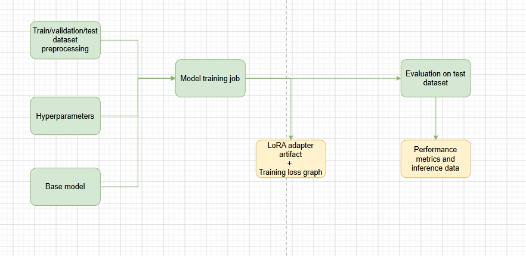

# Training, Evaluation, and Serving Benchmarks

[Back to the README](../README.md)

## Contents

- [Task and model](#task-and-model)
- [Training](#training)
- [Reported evaluation results](#reported-evaluation-results)
- [Serving and benchmarks](#serving-and-benchmarks)
- [Reproducing a comparison](#reproducing-a-comparison)

## Task and model

[ContractNLI](https://stanfordnlp.github.io/contract-nli/), created by Yuta Koreeda and Christopher D. Manning, supplies NDA contracts with labels and evidence for 17 hypotheses. Output uses `hypothesis`, `hypothesis_id`, `label`, and `source_clause`.

The selected model family is [NousResearch/Hermes-4-14B](https://huggingface.co/NousResearch/Hermes-4-14B). Current workflows reference the project's `JerroldK/Hermes-4-14B-contract-extractor` repository and explicit revisions. Adapters are uploaded separately. Review these references before reproduction.

The project reports prompts of approximately 2,000-11,000 tokens and responses that can exceed 2,000 tokens. Input, output, and combined sequence limits must be checked for each training/serving configuration.

## Training

[train_multi.py](../src/scripts/training/train_multi.py) is launched by [evaluate_train.py](../src/evaluate_train.py) through a SageMaker Hugging Face estimator.



*Training produces an adapter revision, training history, and downstream evaluation artifacts.*

The configured training job uses one `ml.g6e.12xlarge` instance with four 48 GB L40S GPUs and PyTorch DistributedDataParallel (DDP). Each process binds to its local GPU and loads a quantized model replica. Tensor/pipeline parallelism is not configured.

The job requests Spot capacity and an S3 checkpoint path. Savings and interruption behavior depend on the environment; resume behavior should be validated separately. The [custom training image](../images/sagemaker_train_job/) has its own dependency stack, separate from the host environment.

### Script defaults

| Setting | Default/configuration |
| --- | --- |
| Epoch limit | 5; subject to early stopping |
| Per-device batch size | 1 |
| Gradient accumulation | 16; workflow-overridable |
| Learning rate | `2e-4`; workflow-overridable |
| LoRA rank / alpha | 16 / 32 |
| Target modules / dropout | `all-linear` / 0.05 |
| Optimizer | `paged_adamw_8bit` |
| Schedule / warmup ratio | Cosine / 0.05 |
| Evaluation/checkpoints | Every 6 optimizer steps |
| Best checkpoint | Lowest validation loss |
| Early stopping | Patience 2; default threshold `1e-3` |

With four processes and default accumulation, the effective batch size is `1 x 16 x 4 = 64`. Notebook experiments also vary accumulation and learning rate; defaults do not identify the historical result runs.

### Memory management

| Technique | Purpose |
| --- | --- |
| 4-bit NF4 with double quantization | Reduce frozen base-weight memory |
| QLoRA | Train adapter matrices while base weights stay frozen |
| BF16 computation | Reduce memory for supported non-quantized components |
| Paged 8-bit AdamW | Reduce optimizer memory |
| Gradient checkpointing | Trade recomputation for activation memory |
| Microbatch 1 and accumulation | Limit per-step memory |
| PyTorch SDPA | Use optimized attention kernels where available |
| Dynamic padding | Avoid fixed maximum-length padding |
| Disabled KV cache | Avoid training-time cache allocation |
| Loss-only evaluation, batch 1 | Limit evaluation memory |
| Local-GPU mapping | Avoid loading all replicas on GPU 0 |
| Expandable CUDA segments | Reduce allocator fragmentation |

These settings support the recorded long-sequence experiments, without guaranteeing arbitrary batch sizes or sequence lengths.

### Training curves

.png>)

*First recorded experiment.*

.png>)

*Second experiment, described in the original notes as using a lower effective batch size and learning rate.*

Evaluation is step-based rather than epoch-based. A curve needs its run record, parameters, and adapter revision to support reproduction.

## Reported evaluation results

| Metric | Hermes-4-14B baseline | Additional evaluation example |
| --- | ---: | ---: |
| Scored documents | 119 | 121 |
| `average_accuracy` | 0.7743 | 0.8763 |
| `average_fmeasure` | 0.6653 | 0.8237 |
| `t_average_fmeasure` | 0.8421 | 0.9220 |
| `min_accuracy` | 0.4706 | 0.6471 |

These values are preserved from the original README. The additional example did not identify a complete run, prompt/dataset version, or adapter revision. It is an illustrative result, not a controlled baseline-versus-fine-tuned comparison.

The evaluator averages document-level label accuracy and extraction scores. Correct `not_mentioned` cases receive extraction score `1.0`. The `t_`/`f_` prefixes denote matching/non-matching labels. Evaluation scripts skip malformed or empty generated JSON; `count` is the scored count, not necessarily the attempted count. See [metric definitions](<model metrics.md>).

<details>
<summary>Original baseline metrics</summary>

```yaml
results:
    count: 119
    average_accuracy: 0.7743450321304992
    average_fmeasure: 0.6653247764082815
    t_average_fmeasure: 0.8421043465572254
    t_average_perc_above_75fmeasure: 0.7567925854010876
    f_average_fmeasure: 0.054894841417625614
    f_average_perc_above_75fmeasure: 0.0374749899959984
    min_accuracy: 0.47058823529411764
    min_t_average_fmeasure: 0.06666666666666667
    min_t_perc_above_75fmeasure: 0
    min_f_average_fmeasure: 0
    min_f_perc_above_75fmeasure: 0
```

</details>

<details>
<summary>Original additional evaluation example</summary>

```python
{'count': 121, 'average_accuracy': 0.8762562296195846, 'average_fmeasure': 0.823687638956293, 't_average_fmeasure': 0.9220109736205447, 't_average_perc_above_75fmeasure': 0.8677144487608757, 'f_average_fmeasure': 0.11022039621650628, 'f_average_perc_above_75fmeasure': 0.08484848484848484, 'min_accuracy': 0.6470588235294118, 'min_t_average_fmeasure': 0.6596318005565962, 'min_t_perc_above_75fmeasure': 0.4, 'min_f_average_fmeasure': 0.0, 'min_f_perc_above_75fmeasure': 0.0}
```

</details>

## Serving and benchmarks

[src/utils.py](../src/utils.py) configures SageMaker endpoints using the LMI asynchronous vLLM backend, FP8 weight/KV-cache settings, LoRA support, and `TENSOR_PARALLEL_DEGREE=1`.

Combined sequence length, batch size, and batched-token budget are configurable. The historical block below mentions a 9,000-token combined limit; longer training inputs do not establish an identical serving limit. Quantization quality and memory limits need task-specific validation.

### Recorded load tests

The summaries have a leading log line before their JSON. Latencies below are converted from milliseconds to seconds.

| Test | Clients | Requests | Failures | Error rate | Mean latency | p99 latency | Reported token throughput |
| --- | ---: | ---: | ---: | ---: | ---: | ---: | ---: |
| [4-client summary](../benchmark/benchmark_summary_4_client_test.json) | 4 | 40 | 2 | 5.00% | 46.59 s | 61.54 s | 43.96 tokens/s |
| [7-client summary](../benchmark/benchmark_summary_7_client_test.json) | 7 | 35 | 4 | 11.43% | 161.09 s | 300.24 s | 22.25 tokens/s |

These exploratory tests include failures and different request counts. They do not establish a production service-level objective or isolate concurrency as the only changed variable. Replace the historical endpoint/adapter in [benchmark.sh](../benchmark/benchmark.sh) before rerunning it.

Raw responses are in [benchmark/](../benchmark/). Endpoint autoscaling is configured in the helpers, but these summaries alone do not validate scaling behavior.

### Historical serving configuration

Preserved from the original README. Review the current code, environment values, and container compatibility before deployment.

<details>
<summary>Recorded LMI/vLLM configuration</summary>

```python
lmi_config = {
        "HF_MODEL_ID": HF_MODEL_ID,
        "HF_TOKEN": os.environ['HF_TOKEN'], 
        "HF_REVISION": HF_REVISION,
        "SERVING_ENGINE": "Python", # https://docs.djl.ai/master/docs/serving/serving/docs/lmi/conceptual_guide/lmi_engine.html
        "OPTION_ROLLING_BATCH": "disable", #vllm disable
        "OPTION_ASYNC_MODE":"true",
        #"max" if enable tensor parallelism
        # 1 enables data parallelism since 1 model per gpu
        "TENSOR_PARALLEL_DEGREE": "1",
        "OPTION_ENTRYPOINT":"djl_python.lmi_vllm.vllm_async_service", # this is from article
        "OPTION_QUANTIZE":"fp8",
        "OPTION_KV_CACHE_DTYPE":"fp8",
        "OPTION_GPU_MEMORY_UTILIZATION":"0.95",
        # "OPTION_ENABLE_CHUNKED_PREFILL":"false",
        # "OPTION_ENABLE_PREFIX_CACHING":"false",
        # "OPTION_ENFORCE_EAGER":"true",
        "OPTION_MAX_MODEL_LEN":MAX_MODEL_LEN, # Max input + output = 6000 + 3000, this is a little buggy because requests close to but under 9000 tokens exceed this hard limit
        "MAX_BATCH_SIZE": BATCH_SIZE, # https://docs.djl.ai/master/docs/serving/serving/docs/lmi/user_guides/starting-guide.html
        "MAX_CONCURRENT_REQUESTS": "200",
        "OPTION_MAX_ROLLING_BATCH_SIZE":BATCH_SIZE, # this is in the amazon articles for async serving
        # https://docs.djl.ai/master/docs/serving/serving/docs/lmi/user_guides/vllm_user_guide.html#advanced-vllm-configurations
        "OPTION_MAX_NUM_BATCHED_TOKENS": BATCH_TOKENS,# Limits the number of tokens that can be processed in a single step during prefill
        # https://docs.vllm.ai/en/v0.8.3/serving/env_vars.html
        "VLLM_ATTENTION_BACKEND":"FLASHINFER", # TORCH_SDPA  FLASH_ATTN
        # The maximum time it will wait to receive a chunk of data from the Python backend. This is when waiting for previous batch to complete.
        "OPTION_PREDICT_TIMEOUT": str(60*15),
        "OPTION_MODEL_LOADING_TIMEOUT": str(60*20),
        "OPTION_TRUST_REMOTE_CODE": "true",
        "SERVING_FAIL_FAST":"true",
        
        "OPTION_ENABLE_LORA": "true", # Enable for dynamic Lora adapters, reserves chunk of KV cache VRAM
        "OPTION_MAX_LORA_RANK": "16",
        "OPTION_PARALLEL_LOADING": "true", # parallel model loading when loading multiple model workers, inc temp memory footprint
        "SERVING_JOB_QUEUE_SIZE": '500', # Default is 1000
    }
```

</details>

## CPU historical replay status

The separate [AWS CPU historical replay](cpu-historical-evaluation.md) has
source/tests prepared, with its cloud check and metrics still pending. It
rescores tracked benchmark response logs against the accepted held-out data.
It does not recreate the 119/121-document evaluation runs above, generate new
responses, verify model/adapter revisions or evaluate the newly registered
CPU prompt. Its request-level and first-attempt metrics will be reported
separately from these original aggregates.

## Reproducing a comparison

Record model/adapter repositories and immutable revisions, dataset tags and document IDs, prompt version, preprocessing, training parameters, inference image/settings, token limits, and metric-code version.

Report attempted, scored, malformed, empty, and other excluded responses, and retain prediction artifacts with their MLRun run references. Use identical evaluated documents and scoring rules before reporting an improvement. JSON validity and exact evidence-span coverage are proposed additional metrics.

Useful upstream references: [Transformers Trainer](https://huggingface.co/docs/transformers/main_classes/trainer), [AWS container images](https://aws.github.io/deep-learning-containers/reference/available_images/), and [DJL vLLM configuration](https://docs.djl.ai/master/docs/serving/serving/docs/lmi/user_guides/vllm_user_guide.html).
